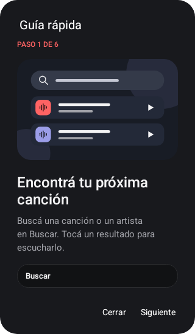
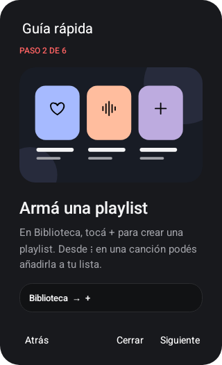
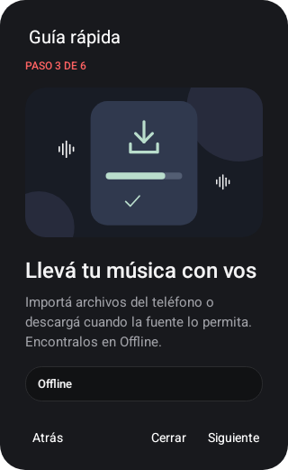
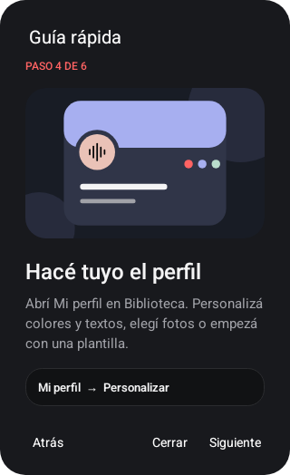
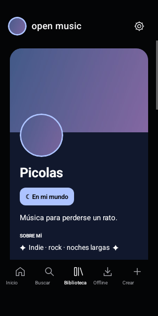
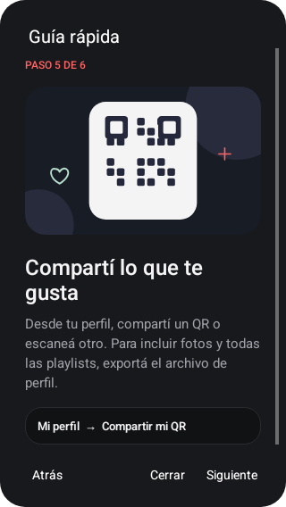
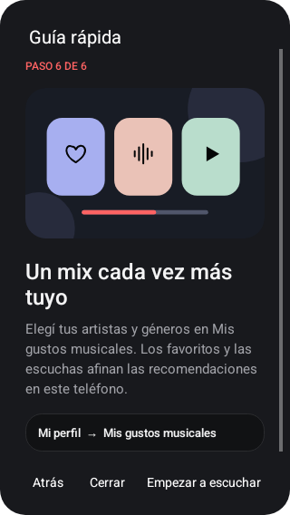

# Guía rápida de Open Music 1.6.1

Abrí **Biblioteca → Mi perfil → Guía rápida** o buscala en **Ajustes**. Las seis ilustraciones están incluidas en la app y funcionan sin conexión. Podés avanzar, volver atrás o cerrar la guía cuando quieras.

## 1. Buscá y escuchá

En **Buscar**, escribí una canción o un artista. Tocá un resultado para reproducirlo. Las fuentes online necesitan conexión.

## 2. Creá una playlist

En **Biblioteca**, tocá **+**. Desde **⋮** en una canción, agregala a tu playlist.

## 3. Escuchá tus archivos

Importá música del teléfono o descargá cuando la fuente lo permita. Encontrala en **Offline**.

## 4. Personalizá tu perfil

Entrá a **Mi perfil → Personalizar perfil**. Cambiá los textos, colores y formas, elegí una plantilla o usá tus fotos como avatar y banner. El editor permite guardar o cancelar.

## 5. Compartí tu música

En tu perfil, usá **Compartir mi QR** o escaneá otro. El QR comparte una copia con el estilo sin fotos. Para incluir imágenes y la colección completa, exportá el archivo de perfil y elegí incluir las fotos. Las playlists ocultas no se incluyen.

## 6. Elegí tus gustos

Abrí **Mis gustos musicales** y seleccioná artistas y géneros. Los favoritos y el historial ayudan a ajustar las recomendaciones locales.

Las imágenes son capturas de la app en el emulador Android 15, con un perfil de prueba.

## Ver el video de una canción

1. Buscá y reproducí una canción de **YouTube**.
2. Tocá el minirreproductor para abrir la canción.
3. Elegí **Video**, debajo de la carátula. La carga puede tardar unos segundos.
4. Usá **Pantalla completa** para ampliar, o **Música** para volver al audio. Se conserva la posición y la pausa.

El video necesita conexión; las descargas siguen siendo audio. Si el video no está disponible, Open Music vuelve a Música. Al salir de esta pantalla o minimizar la app continúa el audio.
